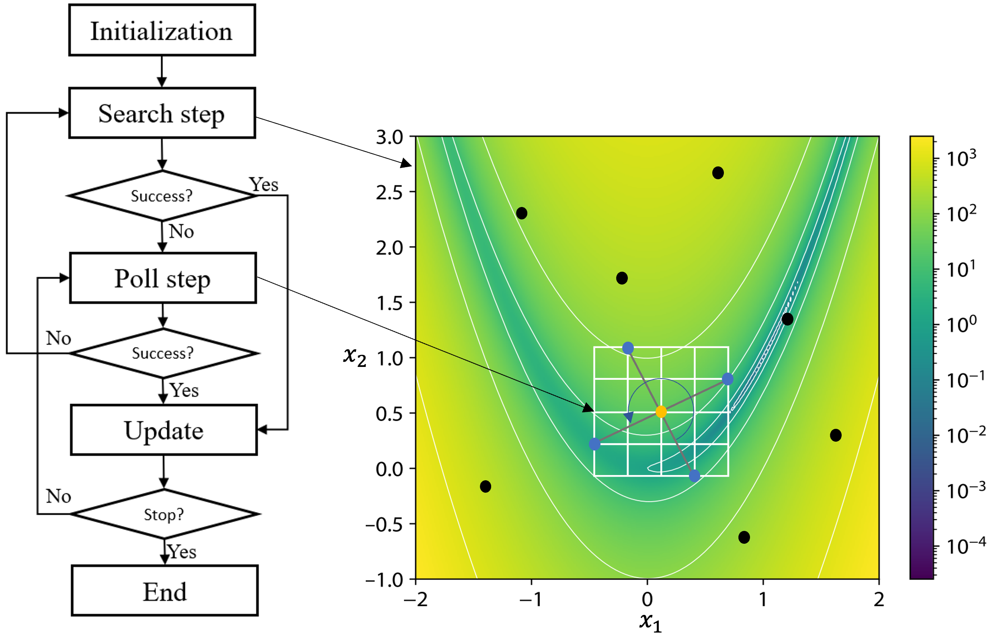
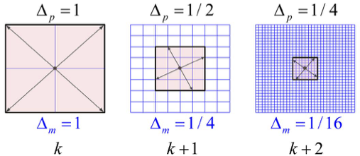
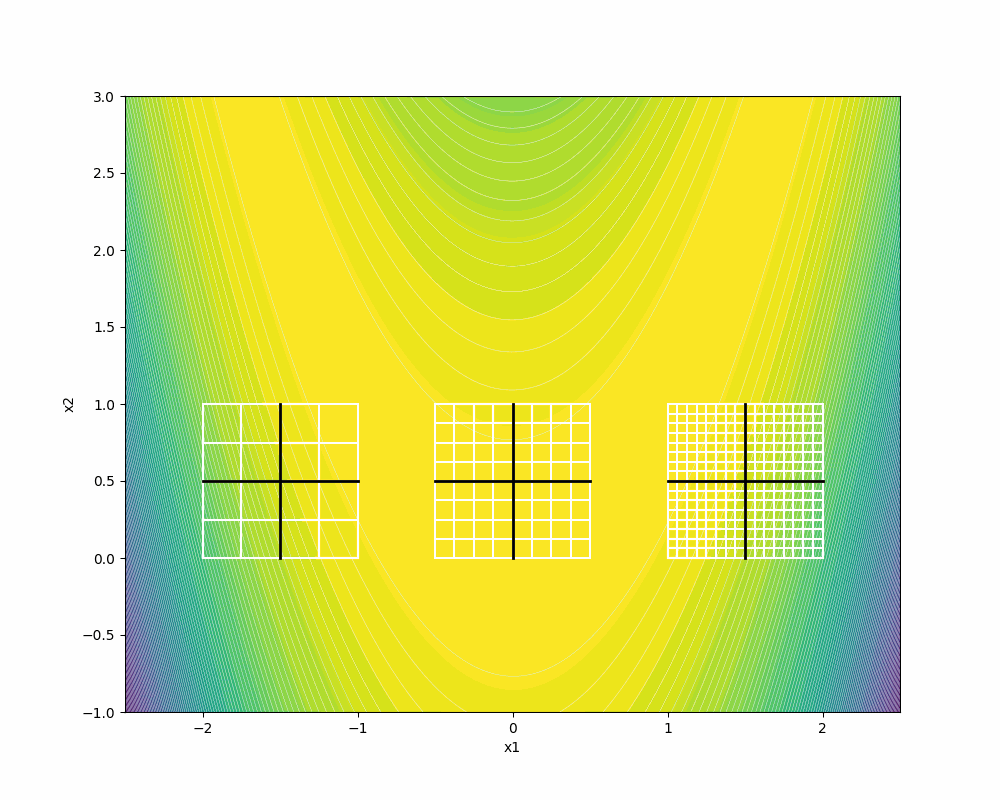

Background
##########

MADS is a derivative-free optimization method supported by a convergence analysis: under
mild assumptions it generates a subsequence of iterates that converges to a point satisfying
first-order (Clarke) optimality conditions, wherever it starts :cite:p:`audet2006mesh`. Each
iteration has two main steps, shown in :numref:`F1`. The first is an optional **search
step**, where any strategy may propose a finite number of trial points on the mesh (a
design of experiments, a surrogate or model optimization, a global heuristic). The second is
the mandatory **poll step**, a local exploration where poll directions spin around the
incumbent solution on the discretized frame, and the blackbox is evaluated at the resulting
poll points.

.. _F1:

   OMADS flow chart.

When to use OMADS
=================

If the optimization problem is deterministic, this checklist helps you decide whether OMADS
is a good choice from a computational-cost point of view.

* If the problem has a known structure with **explicit derivatives**, a gradient-based
  method such as SQP should be used.
* If the derivatives are unknown but **can be reliably approximated** and the design space
  **has no differentiability issues**, a gradient-based or model-based method such as
  NLPQLP is appropriate.
* If the derivatives can be approximated but the design space **has differentiability
  issues**, a model-based derivative-free method such as COBYLA may be preferred.
* If **none of the above applies**, that is, the functions are blackboxes (simulations or
  codes that cannot be differentiated), non-smooth, noisy or liable to fail, a blackbox
  method such as MADS is recommended. This is particularly so when evaluations are
  expensive, or when the problem has hidden or unrelaxable constraints, several objectives,
  or granular variables.

.. note::

   OMADS 2610 is a Pythonic implementation of MADS with a progressive barrier, a granular
   mesh, N+1 poll directions, a quadratic-model search and a density-guided sampling
   search.

Introduction
============

In this section, we present the MADS algorithm. We begin with the definitions of the mesh and
the frame from :cite:p:`audet2017derivative,audet2006mesh`.

.. prf:definition:: Mesh
   :label: def-mesh

   Let :math:`G \in \mathbb{R}^{n\times n}` be an invertible matrix and let the columns of
   :math:`Z \in \mathbb{Z}^{n \times p}` form a positive spanning set for
   :math:`\mathbb{R}^n`. Define :math:`D = GZ`. The mesh of coarseness
   :math:`\delta^{k} > 0` generated by :math:`D`, centred at the incumbent solution
   :math:`x^{k} \in \mathbb{R}^n`, is

   .. math::

      M^{k} := \{ x^{k} + \delta^{k} D y : y \in \mathbb{N}^{p} \} \subset \mathbb{R}^{n},

   where :math:`\delta^{k}` is called the mesh size parameter.

What distinguishes MADS from generalized pattern search (GPS) is a second parameter, the
frame size :math:`\Delta^{k}`, which replaces :math:`\delta^{k}` in the poll step. The frame
size defines the region in which polling happens: the poll directions spin around the
incumbent solution. At every iteration the two parameters satisfy
:math:`0 < \delta^{k} \le \Delta^{k}`.

.. prf:definition:: Frame
   :label: def-frame

   With :math:`G`, :math:`Z` and :math:`D = GZ` as above, select a mesh size parameter
   :math:`\delta^{k} > 0` and let :math:`\Delta^{k}` satisfy :math:`\delta^{k} \le \Delta^{k}`.
   The frame of extent :math:`\Delta^{k}` generated by :math:`D`, centred at
   :math:`x^{k}`, is

   .. math::

      F^{k} := \{ x \in M^{k} : \|x - x^{k}\|_{\infty} \le \Delta^{k} b \},
      \qquad b = \max\{ \|d'\|_{\infty} : d' \in \mathbb{D} \},

   and :math:`\Delta^{k}` is called the frame size parameter.

In MADS, the poll set is built from mesh points inside the frame :math:`F^{k}`. Because the
mesh size shrinks faster than the frame size (:math:`\delta^{k} = \min\{\Delta^{k},
(\Delta^{k})^2\}`), the set of directions that can be chosen keeps growing, which allows an
asymptotically dense set of poll directions; see :numref:`F2`.

.. _F2:

   Mesh and poll updates.

Constraints are handled through the constraint violation function

.. math::

   h(x) = \sum_{j \in \mathcal{P}} \max\{c_j(x), 0\}^2,

computed over the relaxable constraints :math:`\mathcal{P}` (``"PB"``). A point violating an
unrelaxable constraint (``"EB"``) is rejected outright (its violation is reported as
:math:`h_{EB} = \sum_{j \in \mathcal{E}} \max\{c_j(x),0\}^2` and it never enters the
barrier as a candidate centre). A point is **feasible** when :math:`h(x) = 0`.

MADS algorithm
==============

This section explains each step of the MADS algorithm, shown in :numref:`A1`, and how it is
implemented in OMADS. The three public entry points run different subsets of it:
``mads.main`` runs the whole algorithm, ``poll.main`` runs the Update, Poll and Terminate
procedures only, and ``search.main`` replaces the poll with the sampling search.

.. _A1:
.. pcode::
   :linenos:

    \begin{algorithm}
    \caption{Mesh adaptive direct search (MADS) as implemented in OMADS}
    \begin{algorithmic}
    \STATE{Given $f : \mathbb{R}^{n} \mapsto (\mathbb{R} \cup \{ \infty \})^{p}$, constraints $c : \mathbb{R}^{n} \mapsto \mathbb{R}^{m}$, a starting point $x^{0} \in X$ and the violation function $h$}
    \PROCEDURE{Initialization}{}
        \STATE{$\Delta^{0} \in (0, \infty)$} initial frame size
        \STATE{$D=GZ$} positive spanning matrix
        \STATE{$\tau \in (0,1)$, with $\tau$ rational} mesh size adjustment parameter
        \STATE{$\epsilon_{\text{stop}} \in [0,\infty)$} stopping tolerance
        \STATE{$h_{\max}^{0} \in [0,\infty]$} barrier threshold
        \STATE{evaluate $x^{0}$ and insert it in the cache $V^{0}$ and in the barrier}
        \STATE{$k \gets 0$}  iteration counter
    \ENDPROCEDURE
    \PROCEDURE{Update}{}
        \STATE{set the mesh size parameter to $\delta^{k} = \text{min} \{ \Delta^{k}, (\Delta^{k})^{2} \}$}
        \STATE{select the primary and secondary frame centres $x^{k}_{F}$ and $x^{k}_{I}$ from the barrier}
    \ENDPROCEDURE
    \PROCEDURE{Model-Search}{}
        \STATE{$S^{k}_{M} \gets$ the speculative point $x^{k} + (x^{k} - x^{k}_{\text{parent}})$ and the minimizer of a quadratic model of $f$ and $c$}
        \IF{some $t \in S^{k}_{M}$ is a success}
            \STATE set $x^{k+1} \gets t$ and $\Delta^{k+1} \gets \tau^{-1} \Delta^{k}$ and go to \textsc{Terminate}
        \ENDIF
    \ENDPROCEDURE
    \PROCEDURE{Poll}{}
        \IF{the sampling search was successful at iteration $k-1$}
            \STATE go to \textsc{Search}
        \ENDIF
        \STATE select a positive spanning set $\mathbb{D}^{k}_{\Delta}$ such that \\
        $P^{k}=\{x^{k}+\delta^{k}d:d\in\mathbb{D}^{k}_{\Delta}\}$ \\
        is a subset of the frame $F^{k}$ of extent $\Delta^{k}$
        \IF{some $t \in P^{k}$ is a full or partial success}
            \STATE set $x^{k+1} \gets t$ and $\Delta^{k+1} \gets \tau^{-1} \Delta^{k}$ and go to \textsc{Terminate}
        \ELSE
            \STATE set $x^{k+1} \gets x^{k}$ and $\Delta^{k+1} \gets \tau \Delta^{k}$
        \ENDIF
    \ENDPROCEDURE
    \PROCEDURE{Search}{}
        \IF{some $t$ in a finite subset $S^{k}$ of $M^{k}$ is a full or partial success}
            \STATE set $x^{k+1} \gets t$ and $\Delta^{k+1} \gets \tau^{-1} \Delta^{k+1}$ and search again at iteration $k+1$
        \ELSE
            \STATE poll at iteration $k+1$
        \ENDIF
    \ENDPROCEDURE
    \PROCEDURE{Terminate}{}
        \STATE{update the barrier threshold $h^{k+1}_{\max}$}
        \IF{$\Delta^{k+1}\geq \epsilon_{stop}$ and the evaluation budget is not exhausted}
            \STATE increment $k \gets k+1$ and go to \textsc{Update}
        \ELSE
            \STATE stop
        \ENDIF
    \ENDPROCEDURE
    \end{algorithmic}
    \end{algorithm}

.. admonition:: Success types

   OMADS classifies every evaluated trial point :math:`t` against the current frame centres
   (see :numref:`A3`):

   * **Full success**: :math:`t` is feasible and dominates (or equals) the feasible frame
     centre, or :math:`t` is infeasible and dominates the infeasible frame centre.
   * **Partial success**: :math:`t` is infeasible and only reduces the constraint
     violation :math:`h` of the infeasible frame centre.
   * **Unsuccessful**: anything else.

   Successful points enlarge the frame of their own barrier element along the successful
   step; an unsuccessful iteration refines the frame of the feasible frame centre.

Initialization step
-------------------

In this step, OMADS sets the initial frame size :math:`\Delta^{0}`, builds the mesh, adjusts
the initial mesh size and sets the termination criteria before the study starts.

The class responsible for this is ``preprocess``. It reads the input dictionaries and
returns all the objects the main loop needs: the sampler (poll directions ``Dirs2n`` or
search sampler ``EfficientExploration``), the ``Options`` and ``Parameters`` objects, the
post-processor, the adaptive barrier, the run state and statistics, the evaluator and the
cache.

.. code-block:: python

   pre = preprocess(data=data, log=log, sampler_t=SAMPLER_TYPE.POLL)
   (iteration, x0, poll_sampler, options, param, post, out, active_barrier,
    out_p, state, stats, bb_handle, hashtable, ms) = pre.initialize_from_dict()

The ``data`` dictionary holds four sub-dictionaries, ``evaluator``, ``param``, ``options``
and ``search``. Every key is described in :doc:`user_guide/configuration`. The most
important initial values are:

.. list-table::
   :header-rows: 1
   :widths: 30 70

   * - Quantity
     - Where it comes from
   * - :math:`\Delta^{0}`
     - ``options["psize_init"]`` for the orthogonal mesh (default ``1.0``); for the
       granular mesh, ``param["initial_frame_size"]`` or one tenth of each variable range.
   * - :math:`D = GZ`
     - Orthogonal Householder bases, scaled by ``(ub - lb) / scaling``.
   * - :math:`\tau`
     - :math:`1/2` for the orthogonal mesh; the granular mesh walks the mantissas
       :math:`1 \to 2 \to 5 \to 10` (enlarge) and back (refine).
   * - :math:`\epsilon_{\text{stop}}`
     - ``options["tol"]``, applied to the frame size (poll) and the mesh size (search).
   * - :math:`h^{0}_{\max}`
     - ``param["h_max"]`` (default :math:`+\infty`).

Update parameters
-----------------

Each iteration starts by choosing the frame centres from the adaptive barrier
(:numref:`A3`). The barrier keeps three sets: the non-dominated feasible points
:math:`F^{k}`, the infeasible points :math:`U^{k}` with :math:`h \le h^{k}_{\max}` and its
non-dominated subset :math:`I^{k}`. Each barrier element carries **its own mesh**, so frame
sizes adapt per centre, which matters for multi-objective problems.

After the poll or search, ``update`` applies the success logic: on an unsuccessful iteration
it refines the frame of the feasible centre and lowers :math:`h_{\max}`; on a partial
success it lowers :math:`h_{\max}` below the infeasible centre's violation.

.. literalinclude:: ../src/OMADS/_updates/_updates.py
   :language: python
   :pyobject: update
   :caption: The update step (``OMADS/_updates/_updates.py``)
   :class: dropdown

.. _A3:
.. pcode::
   :linenos:

    \begin{algorithm}
    \caption{Progressive barrier: frame centres and threshold update}
    \begin{algorithmic}
    \PROCEDURE{Select-frame-centres}{}
        \IF{phase one, i.e. no evaluated point has $h \leq h^{k}_{\max}$}
            \STATE{$x^{k}_{F} \gets \arg\min_{x \in V^{k}} h(x)$ and there is no secondary centre}
        \ELSE
            \STATE{$x^{k}_{F} \gets$ the point of $F^{k}$ with the largest objective-space gap among those with $\|\Delta\|_{\infty} \geq 10^{-w} \max_{y \in F^{k}} \|\Delta_{y}\|_{\infty}$}
            \STATE{$x^{k}_{I} \gets$ the point of $I^{k}$, with $h \leq h^{k}_{\max}$, farthest from being dominated by $F^{k}$}
            \IF{$F^{k} = \emptyset$}
                \STATE{primary centre $x^{k}_{I}$, no secondary centre}
            \ELSIF{$I^{k} = \emptyset$}
                \STATE{primary centre $x^{k}_{F}$, no secondary centre}
            \ELSIF{$\min_{y \in F^{k}} \sum_{i} \left(f_{i}(y) - \min\{f_{i}(x^{k}_{I}), f_{i}(y)\}\right) \geq \rho \, \text{extent}(F^{k})$}
                \STATE{primary centre $x^{k}_{I}$, secondary centre $x^{k}_{F}$}
            \ELSE
                \STATE{primary centre $x^{k}_{F}$, secondary centre $x^{k}_{I}$}
            \ENDIF
        \ENDIF
    \ENDPROCEDURE
    \PROCEDURE{Update-threshold}{}
        \IF{the iteration is unsuccessful}
            \STATE{refine the frame of $x^{k}_{F}$}
            \STATE{$h^{k+1}_{\max} \gets \max\{h(x^{k}_{I}), \max\{h(y) : y \in U^{k}, h(y) < h^{k}_{\max}\}\}$}
        \ELSIF{the iteration is a partial success}
            \STATE{$h^{k+1}_{\max} \gets \max\{h(y) : y \in U^{k}, h(y) < h(x^{k}_{I})\}$}
        \ELSE
            \STATE{$h^{k+1}_{\max} \gets \max\{h(x^{k}_{I}), \max\{h(y) : y \in U^{k}, h(y) < h^{k}_{\max}\}\}$}
        \ENDIF
        \STATE{remove from $U^{k}$ and $I^{k}$ every point with $h > h^{k+1}_{\max}$}
    \ENDPROCEDURE
    \end{algorithmic}
    \end{algorithm}

The infeasible centre is chosen first when it is "far enough" from the feasible front
(controlled by ``param["rho"]`` and ``options["use_dom_trigger"]``); this is how the
progressive barrier :cite:p:`audet2009progressive` lets OMADS approach the feasible region
from outside. For single-objective problems :math:`F^{k}` holds the best feasible point
only, so :math:`x^{k}_{F}` is simply the incumbent. Dominance comparisons follow
:cite:t:`jaszkiewicz2018ndtree`.

Search step
-----------

The search step helps escape local minimizers, and every trial point is projected onto the
mesh. In ``mads.main`` it comes in two flavours.

**Model search** runs first at every iteration and costs at most two evaluations
(:numref:`A5`). Right after a success, a *speculative* point repeats the last successful step.
Then a quadratic model of the objective, and of each constraint when there are any, is fitted
to cached points around the frame centre and minimized inside a trust region
:cite:p:`conn2013quadratic`. When the model search succeeds, the poll and sampling search are
skipped for that iteration.

.. _A5:
.. pcode::
   :linenos:

    \begin{algorithm}
    \caption{Quadratic model search}
    \begin{algorithmic}
    \PROCEDURE{Speculative-step}{}
        \IF{$x^{k}$ was generated from a parent point $x_{p}$ by a successful step}
            \STATE{$S^{k}_{M} \gets \{\text{clip}_{[\ell,u]}(x^{k} + (x^{k} - x_{p}))\}$}
        \ENDIF
    \ENDPROCEDURE
    \PROCEDURE{Build-models}{}
        \STATE{$r \gets \max\{2\Delta^{k}, r_{M}\} \cdot (u-\ell)/s$} trust-region radius in original units
        \STATE{collect the cached points with $\|(y - x^{k})/r\|_{\infty} \leq 2$, at most twice the size of a full quadratic basis}
        \IF{fewer than $n+2$ points are available}
            \STATE{return $S^{k}_{M}$}
        \ENDIF
        \STATE{fit $m_{f}(s) = c + g^{T}s + \frac{1}{2}s^{T}Hs$ by ridge regression on the quadratic terms}
        \STATE{replace $H$ by its saddle-free version $V|\Lambda|V^{T}$ with eigenvalues floored at $10^{-3}\max|\lambda|$}
        \STATE{fit $m_{c_{j}}$ for each constraint without convexification}
    \ENDPROCEDURE
    \PROCEDURE{Minimize-model}{}
        \IF{there are no constraints}
            \STATE{$s^{*} \gets \arg\min_{s \in [-1,1]^{n}} m_{f}(s)$ by L-BFGS-B from $0$ and from the best regression point}
        \ELSE
            \STATE{$s^{*} \gets \arg\min m_{f}(s)$ s.t. $m_{c_{j}}(s) \leq -\text{margin}_{j}$ by SLSQP}
            \IF{no feasible model decrease exists and $x^{k}$ is infeasible}
                \STATE{$s^{*} \gets \arg\min \sum_{j}\max\{m_{c_{j}}(s),0\}^{2}$}
            \ENDIF
        \ENDIF
        \IF{$s^{*}$ predicts a decrease}
            \STATE{$S^{k}_{M} \gets S^{k}_{M} \cup \{\text{clip}_{[\ell,u]}(x^{k} + r \odot s^{*})\}$}
        \ENDIF
    \ENDPROCEDURE
    \PROCEDURE{Ratio-test}{}
        \STATE{$\varrho \gets$ actual decrease over predicted decrease of the previous constrained model step}
        \IF{$\varrho \geq 0.75$ and the step reached the trust-region boundary}
            \STATE{$r_{M} \gets 2 r$}
        \ELSIF{$\varrho < 0.1$}
            \STATE{$r_{M} \gets \frac{1}{2}\min\{r_{M}, r\}$}
        \ENDIF
    \ENDPROCEDURE
    \end{algorithmic}
    \end{algorithm}

The constraint margin pushes the model minimizer inside the predicted feasible region by
twice the change of each constraint model over half a mesh step, so that projecting it on the
mesh does not make it infeasible. The ratio test lets model steps travel further than the
poll frame along long, flat valleys. The model search applies to single-objective problems
only.

**Sampling search** runs after an unsuccessful poll, and keeps running while it succeeds
(:numref:`A6`). Its behaviour depends on ``search["type"]`` and ``search["s_method"]``. With
the classic samplers (``LH``, ``RS``, ``HALTON``, ``FULLFACTORIAL``) it draws ``ns`` points
in the whole box (or in a neighbourhood of the incumbent). With ``ACTIVE``, OMADS chooses
between strategies from the data it has gathered so far.

.. _A6:
.. pcode::
   :linenos:

    \begin{algorithm}
    \caption{Active sampling search with BiTPE}
    \begin{algorithmic}
    \PROCEDURE{Bootstrap}{}
        \IF{$k = 1$ or fewer than 5 points are cached}
            \STATE{$S^{k} \gets$ Halton or Latin hypercube samples of $[\ell, u]$}
            \RETURN{$S^{k}$}
        \ENDIF
    \ENDPROCEDURE
    \PROCEDURE{Local-split}{}
        \STATE{$T^{k} \gets [x^{k} - r, x^{k} + r] \cap [\ell, u]$ with $r = 2\Delta^{k}(u-\ell)/s$} trust region
        \STATE{keep the cached points nearest to $x^{k}$ in $T^{k}$ units and split them into the best $30\%$ (good) and the rest (bad)}
    \ENDPROCEDURE
    \PROCEDURE{Choose-strategy}{}
        \STATE{ready $\gets$ at least $\max\{5, 3 n_{\text{eff}}\}$ good points and separable good and bad objective values}
        \STATE{stance $\gets$ conservative if the frame is still coarse or the search stagnates, aggressive otherwise}
        \STATE{trust $\gets$ the fraction of the last BiTPE proposals that landed in the good set}
        \IF{ready}
            \STATE{$S^{k} \gets n_{b}$ BiTPE samples in $T^{k}$ (narrow Gaussian kernel, or wide Cauchy and multiquadric kernels if conservative, $n > 15$ or trust $< 0.5$)}
            \STATE{add three line probes from $x^{k}$ towards the faces of $T^{k}$}
        \ELSIF{the search is due to diversify and more than 100 centres are cached}
            \STATE{$S^{k} \gets$ simulated annealing, particle swarm and Latin hypercube samples in $[\ell, u]$}
        \ELSE
            \STATE{$S^{k} \gets$ Halton samples of $T^{k}$}
        \ENDIF
    \ENDPROCEDURE
    \PROCEDURE{Project}{}
        \STATE{project $S^{k}$ on the mesh $M^{k}$, clip it to $[\ell, u]$ and drop cached duplicates}
    \ENDPROCEDURE
    \end{algorithmic}
    \end{algorithm}

BiTPE (bi-population tree-structured Parzen estimation, from samplersLib) resamples from the
density ratio between kernel density estimates of the good and the bad points, in the spirit
of TPE and of trust-region Bayesian optimization :cite:p:`eriksson2019turbo`. Each
model-based step proposes :math:`n_b` points, set by ``search["batch"]`` (10 by default,
capped by the remaining budget), plus three line probes. Readiness alone
decides whether BiTPE runs; a low trust only widens its kernels, so one unlucky round cannot
starve it of the data it needs to recover. When the installed samplersLib supports it, BiTPE
works in a reduced space of :math:`n_{\text{eff}} = \max\{3, \lfloor 0.7n \rfloor\}`
dimensions for :math:`n > 3`. Any sampler failure falls back to Halton sampling of the trust
region for that iteration.

With ``"type": "VNS"`` the search is a variable neighbourhood search that draws points around
the incumbent from Gaussian, gamma, exponential, Poisson and binomial distributions.

.. seealso::

   The search step can also be driven by surrogate models; see StatLML and RAF
   :cite:p:`SML_AB,RAF_AB`.

Poll step
---------

The MADS algorithm may select any poll direction such that :math:`x^{k}+\delta^{k}d` lies
inside the frame, :math:`\|\delta^{k}d\|_\infty \leq \Delta^{k}b` for all
:math:`d \in \mathbb{D}^{k}_{\Delta}`. Since :math:`\Delta^{k}>\delta^{k}` whenever
:math:`\delta^{k} < 1`, there is a lot of freedom in how the poll set is built.

Here is a glimpse of the MADS convergence properties and of what dense sets (richness) of poll
directions mean. In MADS, any direction sampled in the limit of a refining sequence has a
nonnegative Clarke generalized directional derivative. Moreover, the directions come from an
ever-expanding set of options, because the mesh size parameter :math:`\delta^{k}` goes to
zero faster than the frame size parameter :math:`\Delta^{k}`.

MADS can produce an asymptotically dense set of poll directions using Householder matrices.
First, the dense subset:

.. prf:definition:: Asymptotically dense subset
   :label: def-dense

   The set :math:`V \subseteq \mathbb{R}^{n}` is asymptotically dense if the normalized set
   :math:`\{v/\|v\| : v \in V\}` is dense on the *unit sphere*
   :math:`S=\{w\in \mathbb{R}^{n} : \|w\| = 1\}`.

Then the Householder matrix:

.. prf:definition:: Householder matrix
   :label: def-householder

   Let :math:`v \in \mathbb{R}^{n}` be a *normalized vector*. The Householder matrix
   associated with :math:`v` is :math:`H := I - 2vv^{T} \in \mathbb{R}^{n \times n}`, where
   :math:`I` is the :math:`n \times n` *identity matrix*.

Let :math:`v` be a *nonzero* vector of :math:`\mathbb{R}^{n}` and :math:`H` its associated
Householder matrix. Then for any nonzero :math:`\gamma`, :math:`\gamma\,[H \;\; -H]` forms a
maximal positive basis of :math:`\mathbb{R}^{n}`. Keeping only :math:`H` and the negative
sum of its (rounded) columns gives a minimal positive basis of :math:`n+1` directions
:cite:p:`audet2014orthon1`.

.. _A2:
.. pcode::
   :linenos:

    \begin{algorithm}
    \caption{Creating the set of poll directions}
    \begin{algorithmic}
    \PROCEDURE{Create-Householder-matrix}{}
        \IF{rich directions are enabled}
            \STATE{draw $v_{k} \sim \mathcal{N}(0, I_{n})$ and normalize it, $v_{k} \gets v_{k}/\|v_{k}\|_{2}$}
            \STATE{use $v_{k}$ to create its associated Householder matrix $H^{k} = I - 2v_{k}v_{k}^{T}$}
        \ELSE
            \STATE{$H^{k} = I$}
        \ENDIF
        \STATE{$H^{k} = [h_{1} \, h_{2} \, ..., \, h_{n}]$}
    \ENDPROCEDURE
    \PROCEDURE{Create-poll-set}{}
        \STATE{define $\mathbb{B}^{k} = \{b_{1},b_{2}, ..., b_{n}\}$ with $b_{j}=\left\lceil\frac{\Delta^{k}}{\delta^{k}}\frac{h_{j}}{||h_{j}||_{\infty}}\right\rceil$}
        \IF{the direction type is ORTHO 2N}
            \STATE{set $\mathbb{D}^{k}_{\Delta} = \mathbb{B}^{k} \cup (-\mathbb{B}^{k})$ }
        \ELSE
            \STATE{$b_{n+1} = \text{round}\left(\frac{\Delta^{k}}{\delta^{k}}\frac{-\sum_{j} b_{j}}{\|\sum_{j} b_{j}\|_{\infty}}\right)$}
            \STATE{set $\mathbb{D}^{k}_{\Delta} = \mathbb{B}^{k} \cup \{b_{n+1}\}$ }
        \ENDIF
    \ENDPROCEDURE
    \PROCEDURE{Create-poll-points}{}
        \STATE{$P^{k} = \{x^{k} + \delta^{k}\,\text{diag}((u - \ell)/s)\,d : d \in \mathbb{D}^{k}_{\Delta}\}$}
        \STATE{shuffle $P^{k}$, clip it to $[\ell, u]$ and remove repeated points}
        \STATE{project $P^{k}$ on the mesh $M^{k}$ and drop the points already in the cache}
    \ENDPROCEDURE
    \end{algorithmic}
    \end{algorithm}

In OMADS, :numref:`A2` is implemented in the poll class ``Dirs2n``: ``create_housholder``
builds the scaled, rounded direction matrix, ``_ortho_n_plus_1`` builds the
:math:`n+1` set (``options["direction_type"] = "N+1"``, real variables only) and
``create_poll_set`` turns the directions into candidate points.

.. literalinclude:: ../src/OMADS/_directions/_directions.py
   :language: python
   :pyobject: Dirs2n.create_housholder
   :caption: ``Dirs2n.create_housholder`` (``OMADS/_directions/_directions.py``)
   :class: dropdown

.. literalinclude:: ../src/OMADS/_directions/_directions.py
   :language: python
   :pyobject: Dirs2n._ortho_n_plus_1
   :caption: ``Dirs2n._ortho_n_plus_1``
   :class: dropdown

.. literalinclude:: ../src/OMADS/_directions/_directions.py
   :language: python
   :pyobject: Dirs2n.create_poll_set
   :caption: ``Dirs2n.create_poll_set``
   :class: dropdown

:numref:`F3` shows the dense directions on the same frame size.

.. _F3:

   Poll set of dense directions.

We recommend :cite:p:`audet2017derivative` for the proofs showing that the columns of the
associated Householder matrices are asymptotically dense, given a dense set of directions on
the unit sphere :math:`S`.

Mesh update
-----------

OMADS has two meshes, selected with ``param["mesh_type"]``.

**Orthogonal mesh (default).** ``Omesh`` keeps one frame size per variable and applies
:math:`\tau = 1/2`:

.. math::

   \Delta^{k+1}_i =
   \begin{cases}
      2\,\Delta^{k}_i & \text{after a success,}\\
      \Delta^{k}_i / 2 & \text{after a failure,}
   \end{cases}
   \qquad
   \delta^{k+1}_i = \min\{\Delta^{k+1}_i, (\Delta^{k+1}_i)^2\}.

**Granular mesh** (``GMESH``). ``Gmesh`` implements the granular, anisotropic mesh of
:cite:t:`audet2019granular`. Each frame size is :math:`\Delta_i = a_i \times 10^{b_i}` with
mantissa :math:`a_i \in \{1, 2, 5\}`, and may be a multiple of a granularity :math:`g_i`
(``param["granularity"]``). The update rules are given in :numref:`A4`:

* **refinement** (every ``options["refine_freq"]`` failures): :math:`a_i` follows
  :math:`5 \to 2 \to 1 \to 5\,(b_i - 1)`, never below the minimum mesh size;
* **enlargement**: :math:`a_i` follows :math:`1 \to 2 \to 5 \to 1\,(b_i + 1)`, only for the
  coordinates where the successful step was large relative to the mesh,
  :math:`|d_i| / (\delta_i \rho_i) >` ``options["anisotropy_factor"]`` (when
  ``options["anistropic_mesh"]`` is true), and never beyond the variable range.

.. _A4:
.. pcode::
   :linenos:

    \begin{algorithm}
    \caption{Granular mesh update}
    \begin{algorithmic}
    \PROCEDURE{Enlarge}{$d$}
        \FOR{$i = 1, \dots, n$}
            \IF{$\Delta_{i} < \Delta^{\max}_{i}$ and ($|d_{i}| / (\delta_{i}\rho_{i}) > \alpha$ or the mesh is isotropic)}
                \STATE{$(a_{i}, b_{i}) \gets$ next larger mantissa and exponent in $\{1,2,5\} \times 10^{b}$}
                \STATE{$r_{i} \gets r_{i} + 1$} mesh index
            \ENDIF
        \ENDFOR
    \ENDPROCEDURE
    \PROCEDURE{Refine}{}
        \FOR{$i = 1, \dots, n$}
            \STATE{$(a'_{i}, b'_{i}) \gets$ next smaller mantissa and exponent in $\{1,2,5\} \times 10^{b}$}
            \IF{$\delta^{\min}_{i} \leq \delta_{i}$}
                \STATE{$(a_{i}, b_{i}) \gets (a'_{i}, b'_{i})$ and $r_{i} \gets r_{i} - 1$}
            \ENDIF
        \ENDFOR
    \ENDPROCEDURE
    \end{algorithmic}
    \end{algorithm}

Termination
-----------

The algorithm stops when one of the following happens:

* the evaluation budget ``options["budget"]`` is exhausted;
* every component of the frame size (poll) or of the mesh size (search) falls below
  ``options["tol"]``;
* the number of trial points that hit the bounds exceeds ``options["noutbound_hits_max"]``;
* a feasible point is found during phase one (the run then continues in phase two).

The reason is written to ``OMADS.log`` in the post directory.
