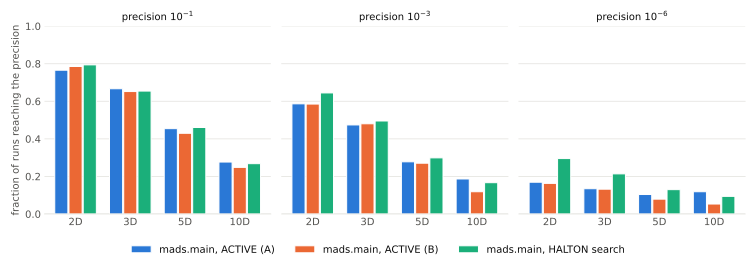

Benchmarking
############

This section describes how OMADS 2610 is benchmarked: the regression suite that runs on
every commit, and the COCO ``bbob-constrained`` runner for large studies.

Regression suite
================

``tests/test_OMADS_BASIC.py`` runs on Linux, Windows and macOS in continuous integration.
Every solver must reach a target value within a fixed budget. For the 10D and 20D
Rosenbrock problems, the target is the **median over three seeds** (single-seed results
swing too much with the random direction stream).

.. list-table::
   :header-rows: 1
   :widths: 36 10 16 38

   * - Problem
     - :math:`n`
     - Budget
     - Solver: target
   * - Rosenbrock, :math:`x^0 = (-2.5, \dots)`
     - 2
     - 3500
     - mads ≤ 0.005, poll ≤ 0.008, search ≤ 0.07
   * - Thin constrained band (2 PB constraints)
     - 2
     - 2000
     - mads ≤ 0.0989
   * - Rosenbrock (ORTHO N+1)
     - 10
     - 4000 / 3000
     - mads ≤ 9.7, poll ≤ 8, search ≤ 7.3
   * - Rosenbrock (ORTHO N+1)
     - 20
     - 5000
     - mads ≤ 20.5, poll ≤ 20, search ≤ 24.3
   * - Geometric programming (6 PB constraints)
     - 10
     - 10000
     - poll ≤ 27 (median)
   * - Sellar, IDF formulation (GMESH)
     - 4
     - 150
     - runs to completion

The 2D Rosenbrock test also runs every solver in parallel mode (``np = 4``) and checks the
same targets.

Run the suite locally with:

.. code-block:: console

   $ pip install -e ".[test]"
   $ pytest tests -v

COCO ``bbob-constrained``
=========================

``benchmarks/coco/run_mads_bbob_constrained.py`` runs ``mads.main`` on the 54 functions of the
COCO ``bbob-constrained`` suite :cite:p:`coco2021`. Each COCO problem
:math:`x \mapsto f(x)` with constraints :math:`g(x) \le 0` becomes a callable blackbox
returning ``[f, g]``, and every constraint uses the progressive barrier. A run stops as soon
as COCO's final target is hit, and an unsolved instance is restarted (new start point and
seed) until its ``budget_multiplier × dimension`` evaluations are used; COCO records the
restarts of an instance as one trial. The seed and the start point of each restart depend
only on the instance and the restart number, so any subset of the suite or batch split
reproduces the same runs.

The runner's defaults are the configuration published below (``--preset A``): the
``ACTIVE`` sampling search with :math:`n_s = \min\{(n+1)(n+2)/2,\ 2n\}`, the ``ORTHO_N+1``
poll and opportunistic evaluation, on dimensions 2, 3, 5 and 10, instances 1 to 15, with a
budget of :math:`100\,n`. The other published configurations are available as presets, and
any option overrides its preset value.

.. code-block:: console

   $ pip install -r benchmarks/coco/requirements.txt
   $ python benchmarks/coco/run_mads_bbob_constrained.py                  # preset A
   $ python benchmarks/coco/run_mads_bbob_constrained.py --preset halton
   $ python benchmarks/coco/run_mads_bbob_constrained.py -d 2,3,5 -f 1-12 -i 1-3 \
         --budget-multiplier 50

Results go to ``exdata/<output-folder>`` and are post-processed with ``cocopp`` into an
HTML report under ``ppdata/``. Large runs can be split over several processes with
``--batches N --batch k``; post-process all the batch folders together with
``python -m cocopp exdata/...``.

.. list-table:: Presets of the COCO runner
   :header-rows: 1
   :widths: 14 18 68

   * - Preset
     - COCO name
     - Configuration
   * - ``A`` (default)
     - ``OMADS-A``
     - ``ACTIVE`` search, :math:`n_s = \min\{(n+1)(n+2)/2,\ 2n\}`, ``ORTHO_N+1`` poll,
       opportunistic.
   * - ``B``
     - ``OMADS-B``
     - ``ACTIVE`` search, :math:`n_s = (n+1)(n+2)/2`, after every third failed poll,
       ``ORTHO_N+1`` poll, opportunistic.
   * - ``halton``
     - ``OMADS-Halton``
     - ``HALTON`` search, :math:`n_s = 1` (56 on f43 to f54), ``ORTHO_2N`` poll.
   * - ``initial``
     - ``OMADS-ACTIVE``
     - ``ACTIVE`` search, :math:`n_s = (n+1)(n+2)/2 + 10`, ``ORTHO_2N`` poll.

.. list-table:: Main options of the COCO runner
   :header-rows: 1
   :widths: 30 20 50

   * - Option
     - Default
     - Meaning
   * - ``--preset``
     - ``A``
     - Published configuration (see the table above).
   * - ``--budget-multiplier``, ``-b``
     - ``100``
     - Evaluations per instance, times the dimension.
   * - ``--dimensions``, ``-d``
     - ``2,3,5,10``
     - Dimensions to run (the suite has 2, 3, 5, 10, 20, 40).
   * - ``--functions``, ``-f``
     - all
     - Function indices, e.g. ``1-18`` (1 to 54).
   * - ``--instances``, ``-i``
     - ``1-15``
     - Instance indices.
   * - ``--s-method``
     - preset
     - Sampling method of the search step (``ACTIVE``, ``HALTON``, ``LH``, ...).
   * - ``--ns`` / ``--ns-multimodal``
     - preset
     - Samples per search step on f1 to f42 and on the multimodal Rastrigin functions
       f43 to f54: an integer, ``quad`` for :math:`(n+1)(n+2)/2`, ``min2n`` for
       :math:`\min\{(n+1)(n+2)/2,\ 2n\}` or ``auto`` for :math:`(n+1)(n+2)/2 + 10`.
   * - ``--search-every``
     - preset
     - Run the sampling search after every k-th consecutive failed poll only.
   * - ``--direction-type``
     - preset
     - Poll directions: ``ORTHO_2N`` or ``ORTHO_N+1``.
   * - ``--opportunistic`` / ``--no-opportunistic``
     - preset
     - Stop evaluating a poll or search set at its first improvement.
   * - ``--mesh-type``
     - ``GMESH``
     - ``GMESH`` (anisotropic granular mesh) or ``ORTHO``.
   * - ``--anisotropy-factor``
     - ``0.05``
     - GMESH anisotropy factor.
   * - ``--min-mesh-size``
     - ``1e-13``
     - GMESH minimum mesh size.
   * - ``--on-min-mesh``
     - ``stop``
     - When the poll size falls below ``--tol`` with budget left: ``stop`` the run (it is
       then restarted from a new point) or keep running the sampling ``search`` with the
       initial mesh until it improves (``"on_min_mesh"`` option of ``mads``).
   * - ``--seed``
     - ``1234``
     - Base seed, offset at each restart.
   * - ``--max-restarts``
     - ``20``
     - Maximum number of runs per instance.
   * - ``--only``
     - all
     - File listing the problems to run, one ``function dimension instance`` per line.
   * - ``--folder-per-instance``
     - off
     - Write each instance to its own folder, so that data sets can be assembled instance
       by instance.
   * - ``--batches``, ``--batch``
     - ``1``, ``1``
     - Split the suite and pick the batch run by this process.

Results on ``bbob-constrained``
===============================

Experimental setup
------------------

OMADS 2610 was run on the 54 functions of ``bbob-constrained`` in dimensions 2, 3, 5 and 10,
on instances 1 to 15, with a budget of :math:`100\,n` function evaluations per instance
(810 runs per dimension). All runs use ``mads.main`` with the settings of the COCO runner
(granular mesh, progressive barrier on every constraint). The quadratic model search runs
first at every iteration in all configurations; they differ in the sampling search and the
poll.

.. list-table::
   :header-rows: 1
   :widths: 24 76

   * - Label
     - Configuration
   * - ``ACTIVE (A)``
     - ``"s_method": "ACTIVE"`` (BiTPE) with smaller batches,
       :math:`n_s = \min\{(n+1)(n+2)/2,\ 2n\}` (4, 6, 10 and 20 in dimensions 2, 3, 5 and
       10); ``ORTHO_N+1`` poll; ``"opportunistic": True``.
   * - ``ACTIVE (B)``
     - ``"s_method": "ACTIVE"`` (BiTPE) with :math:`n_s = (n+1)(n+2)/2`, run only after every
       third consecutive unsuccessful poll (``"search_every": 3``); ``ORTHO_N+1`` poll;
       ``"opportunistic": True``.
   * - ``HALTON``
     - ``"s_method": "HALTON"``, :math:`n_s = 1` (:math:`n_s = 56` on the multimodal
       functions f43 to f54); ``ORTHO_2N`` poll; the default of the COCO runner.
   * - ``ACTIVE, ns = (n+1)(n+2)/2 + 10``
     - ``"s_method": "ACTIVE"`` with :math:`n_s = (n+1)(n+2)/2 + 10` after every
       unsuccessful poll; ``ORTHO_2N`` poll. A first configuration, reported in
       :numref:`T-coco-summary` only.

With the ``ACTIVE`` search, each model-based search step evaluates up to :math:`n_s` BiTPE
proposals plus three line probes (the runner sets ``search["batch"]`` to :math:`n_s`;
OMADS' default is 10); with ``"opportunistic": True`` the evaluation of a poll or
search set stops at its first improvement.

The reference algorithms are the 2022 entries of the COCO data archive: COBYLA and AL1-CMA-ES
(Dufossé), fmincon (Hellwig) and random search. These were run with much larger budgets, up to
:math:`10^{7}\,n` evaluations. Note that COCO counts every constraint evaluation in addition to
the objective evaluation ("evals = f-evals + g-evals"), which is why the OMADS curves extend
beyond :math:`\log_{10}(100) = 2` on the horizontal axis.

Fraction of solved runs
-----------------------

:numref:`F-coco-summary` and :numref:`T-coco-summary` report, for each configuration and
dimension, the fraction of the 810 runs whose final precision :math:`f - f_{\text{opt}}`
reached :math:`10^{-1}`, :math:`10^{-3}` and :math:`10^{-6}` within the budget.

.. _F-coco-summary:

   Fraction of ``bbob-constrained`` runs (54 functions × 15 instances) reaching a given
   precision within :math:`100\,n` evaluations, for three configurations of ``mads.main``.

.. _T-coco-summary:
.. csv-table:: Fraction of runs reaching each precision (data of :numref:`F-coco-summary`).
   :file: media/figures/coco/coco_summary.csv
   :header-rows: 1

Runtime distributions
---------------------

The grid in :numref:`F-coco-ecdf` shows the empirical cumulative distribution functions
(ECDFs) of the runtime, aggregated over all 54 functions, as computed by ``cocopp``. Each curve
gives the fraction of (function, target) pairs, for 41 targets between :math:`10^{2}` and
:math:`10^{-6}`, solved after a given number of evaluations divided by the dimension.
``OMADS-A``, ``OMADS-B`` and ``OMADS-Halton`` stand for ``ACTIVE (A)``, ``ACTIVE (B)`` and
``HALTON``. A curve is solid over the recorded runs, up to the median budget of the solver
(●), and dotted beyond it, where ``cocopp`` simulates restarts by chaining unsuccessful runs.
The shaded band is the OMADS budget. Each curve is labelled with its value at the OMADS
budget and at :math:`10^{7}\,n` evaluations, since the reference algorithms used budgets up to
:math:`10^{5}` times larger.

.. _F-coco-ecdf:
.. list-table:: Runtime ECDFs aggregated over all ``bbob-constrained`` functions, in 2, 3,
   5 and 10 dimensions.
   :class: figure-grid

   * - .. image:: media/figures/coco/ecdf_02D.svg
     - .. image:: media/figures/coco/ecdf_03D.svg
   * - .. image:: media/figures/coco/ecdf_05D.svg
     - .. image:: media/figures/coco/ecdf_10D.svg

Discussion
----------

* The cost of the ``ACTIVE`` search decides its usefulness at this budget. With
  :math:`n_s = (n+1)(n+2)/2 + 10` after every unsuccessful poll, a search step costs up to
  :math:`79` of the :math:`1000` evaluations available in dimension 10, and fewer than 10%
  of the runs reach :math:`10^{-1}` in any dimension. Capping the batch at :math:`2n`
  (``ACTIVE (A)``), or running the search after every third failed poll only
  (``ACTIVE (B)``), together with the cheaper ``ORTHO_N+1`` poll and opportunistic
  evaluation, brings the ``ACTIVE`` search level with the ``HALTON`` configuration.
* In dimension 10, ``ACTIVE (A)`` is the best configuration at every precision: 27.7% of
  the runs reach :math:`10^{-1}` (26.8% for ``HALTON``), 18.6% reach :math:`10^{-3}`
  (16.7%) and 11.9% reach :math:`10^{-6}` (9.4%). In dimension 5, ``ACTIVE (A)`` is within
  three points of ``HALTON`` at every precision.
* In dimensions 2 and 3, ``HALTON`` remains ahead at tight precisions (:math:`10^{-6}` is
  reached by 29.5% of the runs against 16.9% for ``ACTIVE (A)`` in dimension 2, and 21.4%
  against 13.5% in dimension 3); there the one-point sampling search leaves almost the whole
  budget to the model search and the poll.
* The runtime distributions (:numref:`F-coco-ecdf`) give a complementary view, over 41
  targets instead of three precisions. In dimension 2, within the budget of :math:`100\,n`
  evaluations, both ``ACTIVE`` configurations solve about 61% of the (function, target)
  pairs and ``HALTON`` 67%; at the same number of evaluations COBYLA solves 94%, fmincon 76%
  and AL1-CMA-ES 8%. With the restarts simulated by ``cocopp``, the ``ACTIVE``
  configurations reach 97% (``A``) and 98% (``B``), more than ``HALTON`` (91%) and fmincon
  (92%), and close to COBYLA and AL1-CMA-ES (100%), which use up to :math:`10^{7}\,n`
  evaluations. In dimension 10, ``ACTIVE (A)`` solves the most pairs, both within the budget
  (28%, against 27% for ``HALTON`` and 24% for ``ACTIVE (B)``) and with restarts (58%, 57%
  and 52%).
* Smaller batches generalize better than a less frequent search: ``ACTIVE (B)``, which keeps
  the large batches, is close to ``ACTIVE (A)`` in dimensions 2 to 5 but falls behind in
  dimension 10.
* Continuing the sampling search when the poll size falls below ``tol``
  (``"on_min_mesh": "search"``), instead of restarting the run from a new point, does not
  change these results. Only 2% to 6% of the instances stop before their budget (101, 66
  and 186 of 3240 for ``ACTIVE (A)``, ``ACTIVE (B)`` and ``HALTON``, none for the first
  ``ACTIVE`` configuration); rerun with the continuation, 81, 47 and 169 of them end at the
  same value, the others split between gains and losses (11/9, 5/14 and 17/0), and every
  fraction above is unchanged to the third decimal. With ``HALTON``, the continuation
  mostly stalls (its points around the incumbent are already in the cache) and the run is
  restarted anyway.
* COBYLA and fmincon, two model-based local solvers, are faster on these constrained,
  mostly smooth functions; they also reach more targets because they were run with budgets
  several orders of magnitude larger.

Results reproducibility
-----------------------

The results above are reproduced, from the benchmark runs to the figures and the table of
this page, by a single script.

**Requirements.** Python 3.10 or newer and an internet connection (``cocopp`` downloads the reference algorithms from the COCO data
archive on first use). From the root of the OMADS repository, install OMADS and the
benchmarking packages (``coco-experiment``, ``cocopp`` and ``matplotlib``):

.. code-block:: console

   $ python -m pip install -e .
   $ python -m pip install -r benchmarks/coco/requirements.txt

**Run.**

.. code-block:: console

   $ python benchmarks/coco/reproduce_results.py

The script

#. runs the four presets ``A``, ``B``, ``halton`` and ``initial`` of
   ``run_mads_bbob_constrained.py`` on dimensions 2, 3, 5 and 10, instances 1 to 15, with a
   budget of :math:`100\,n`, each split into 12 batches executed in parallel (a batch that
   fails is run again once);
#. gathers the batches of each preset into ``exdata/OMADS-A``, ``exdata/OMADS-B``,
   ``exdata/OMADS-Halton`` and ``exdata/OMADS-ACTIVE``, with one folder per instance and
   a ``runs.txt`` log of the runs each instance needed;
#. post-processes ``OMADS-A``, ``OMADS-B`` and ``OMADS-Halton`` with ``cocopp`` against
   COBYLA, AL1-CMA-ES, fmincon and random search (full HTML report in ``ppdata/repro``);
#. draws the runtime ECDFs (:numref:`F-coco-ecdf`) from the ``cocopp`` curves with
   ``plot_ecdf.py``, in a light and a dark version, and, from all four presets, the summary
   chart and table (:numref:`F-coco-summary` and :numref:`T-coco-summary`) to
   ``docs_src/media/figures/coco``; the 2D ECDF shown in the README is copied to
   ``docs_src/_static``. Rebuild the documentation with
   ``sphinx-build -b html docs_src docs`` to update this page.

On a 24-core workstation with 20 parallel processes (``--workers 20``), the runs of the four
presets take about 1.8 hours, and ``cocopp`` about 15 minutes more.

.. list-table:: Options of ``reproduce_results.py``
   :header-rows: 1
   :widths: 30 25 45

   * - Option
     - Default
     - Meaning
   * - ``--presets``
     - ``A,B,halton,initial``
     - Presets to run.
   * - ``--workers``
     - half the CPU cores, at most 12
     - Parallel processes. On a 64 GB machine, 12 processes run without problems while 24
       run out of memory; lower it if batches fail with memory errors.
   * - ``--batches``
     - ``12``
     - Batches per preset.
   * - ``-d``, ``-f``, ``-i``
     - runner defaults
     - Dimensions, functions and instances, for a reduced reproduction.
   * - ``--workdir``
     - repository root
     - Folder that receives ``exdata/`` and ``ppdata/repro``.
   * - ``--figures``
     - ``docs_src/media/figures/coco``
     - Where the figures and table are written.
   * - ``--skip-runs``
     - off
     - Reuse existing ``exdata/`` data and only post-process.
   * - ``--on-min-mesh``
     - ``stop``
     - Passed to the runner; with ``search`` the algorithms are named ``<name>-search`` and
       the report and figures go to ``ppdata/repro-search``.
   * - ``--reuse``
     - off
     - ``exdata/`` folder of an earlier campaign of the same code: only the instances it
       restarted are run again, the others are copied (their runs do not depend on
       ``--on-min-mesh``).

A single configuration can also be run on its own, for example
``python benchmarks/coco/run_mads_bbob_constrained.py --preset B``, and post-processed with
``benchmarks/coco/postprocess_bbob_constrained.py`` and
``benchmarks/coco/summarize_bbob_constrained.py``.

.. note::

   With a given version of OMADS and of its dependencies, the runs are deterministic: a
   campaign, a batch or a single instance (``--only``) reproduces the same evaluations.
   Changes to the code, or to NumPy and SciPy, change individual runs; the aggregated
   fractions and runtime distributions then typically move by one or two percentage points.

Toy problems
============

Results on the 2D toy functions, from the :doc:`tutorials/toy_problems`, with
``mads.main``, seed 0 and a 1000-evaluation budget (2000 for Eggholder):

.. list-table::
   :header-rows: 1
   :widths: 22 22 22 17 17

   * - Function
     - Global minimum
     - OMADS ``fmin``
     - Evaluations
     - Search
   * - Rosenbrock
     - 0
     - 0.0
     - 223
     - ACTIVE
   * - Alpine
     - 0
     - 4.5e-06
     - 270
     - ACTIVE
   * - Ackley 3
     - −186.4112
     - −186.4112
     - 253
     - ACTIVE
   * - Eggholder
     - −959.6407
     - −959.6407
     - 871
     - LH, ``ns = 30``
