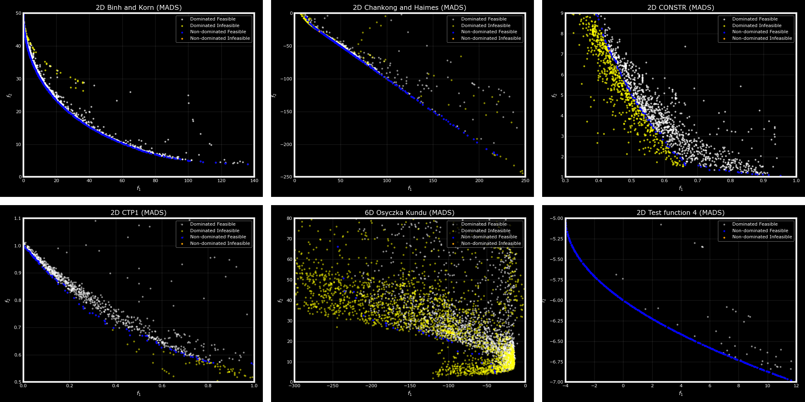
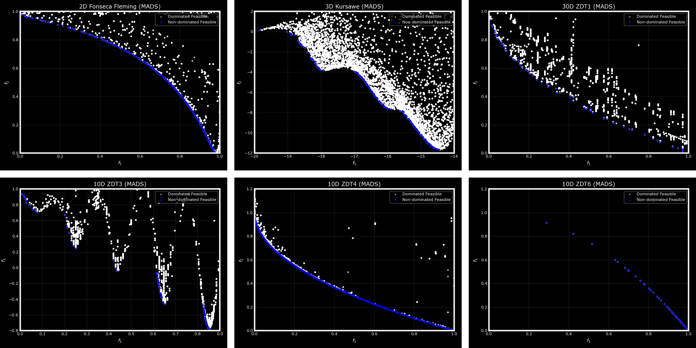

OMADS: Optimization using Mesh Adaptive Direct Search
=====================================================

| **Author:** Ahmed H. Bayoumy
| **Release:** |release|
| **Source:** https://github.com/Ahmed-Bayoumy/OMADS
| **DOI:** `10.5281/zenodo.23407559 <https://doi.org/10.5281/zenodo.23407559>`_

Overview
--------

OMADS is a Python implementation of the Mesh Adaptive Direct Search (MADS) algorithm
:cite:p:`audet2006mesh` for blackbox optimization. It addresses problems of the form

.. math::

   \min_{x \in \Omega} f(x), \qquad
   \Omega = \{x \in X : c_j(x) \le 0,\; j = 1,\dots,m\}, \qquad
   X = \{x \in \mathbb{R}^n : \ell \le x \le u\},

where the objective :math:`f` (scalar- or vector-valued) and the constraints :math:`c_j` are
available only through evaluation: no derivatives are provided, and the functions may be
non-smooth, noisy, expensive, or undefined at some points. MADS is a direct search method
with a convergence analysis based on the Clarke nonsmooth calculus. OMADS combines it with
a progressive barrier, a granular mesh, a quadratic-model search and a density-guided
sampling search.

Main features
-------------

* Three solvers sharing one input format: the complete algorithm (``mads``), the poll step
  alone (``poll``), and the search step alone (``search``).
* Orthogonal poll directions derived from Householder matrices, with :math:`2n`
  (``ORTHO_2N``) or :math:`n+1` (``ORTHO_N+1``) directions :cite:p:`audet2014orthon1`.
* The classical orthogonal mesh and the anisotropic granular mesh
  :cite:p:`audet2019granular`.
* Constraint handling by the progressive barrier and the extreme barrier
  :cite:p:`audet2009progressive`, with primary and secondary frame centres.
* A speculative step and a constraint-aware quadratic model search at every iteration
  :cite:p:`conn2013quadratic`.
* An adaptive sampling search based on a bi-population tree-structured Parzen estimator
  (BiTPE), with Halton, Latin hypercube, simulated annealing and particle swarm alternatives.
* Multi-objective (Pareto) studies assessed by the hypervolume indicator.
* Evaluation cache, opportunistic strategy, parallel evaluation, CSV logs and reproducible
  random seeds.

Minimal example
---------------

.. code-block:: python

   import numpy as np
   from OMADS import mads

   def rosenbrock(x):
       x = np.asarray(x)
       f = np.sum(100.0 * (x[1:] - x[:-1] ** 2) ** 2 + (1 - x[:-1]) ** 2)
       return [f, [0]]              # [objective, list of constraints c(x) <= 0]

   data = {
       "evaluator": {"blackbox": rosenbrock},
       "param": {"name": "rosen", "baseline": [-2.0, -2.0], "lb": [-5, -5],
                 "ub": [10, 10], "scaling": [15, 15], "post_dir": "./post"},
       "options": {"seed": 0, "budget": 1000, "tol": 1e-9, "rich_direction": True,
                   "store_cache": True, "check_cache": True},
       "search": {"type": "sampling", "s_method": "ACTIVE", "ns": 10},
   }

   out, *_ = mads.main(data)
   print(out["xmin"], out["fmin"])  # [1.0, 1.0] [0.0]  (223 evaluations)

Organization of this documentation
----------------------------------

:doc:`getting_started`
   Installation, a first run, and the structure of the input.
:doc:`background`
   Definitions, convergence-related concepts and the algorithms implemented in OMADS, given
   as pseudocode.
:doc:`benchmarking`
   The regression suite and the COCO ``bbob-constrained`` experiment.
:doc:`tutorials/index`
   Worked examples: test functions, constrained and multi-objective problems, external
   simulators, parallel evaluation and post-processing.
:doc:`user_guide/configuration` and :doc:`user_guide/outputs`
   Complete description of the input keys, their defaults, and the files produced by a run.
:doc:`api/index`
   Reference of the solver entry points and of the classes behind them.

Multi-objective results
-----------------------

The figures below show Pareto fronts obtained by OMADS on constrained (top) and
unconstrained (bottom) bi-objective test problems from the literature.

Citation
--------

If OMADS contributes to published work, please cite it as follows.

.. code-block:: bibtex

   @software{OMADS_AB,
     author    = {Bayoumy, Ahmed H.},
     title     = {OMADS: Optimization using Mesh Adaptive Direct Search},
     year      = {2022},
     publisher = {GitHub},
     version   = {2610},
     doi       = {10.5281/zenodo.23407559},
     url       = {https://github.com/Ahmed-Bayoumy/OMADS}
   }

License
-------

© Ahmed H. Bayoumy 2022–2026. OMADS is free software distributed under the GNU General
Public License, version 3 or later; see the
`LICENSE <https://github.com/Ahmed-Bayoumy/OMADS/blob/DEV/LICENSE>`_ file.

.. toctree::
   :hidden:
   :caption: Getting started

   getting_started

.. toctree::
   :hidden:
   :caption: Technical Documentation

   background
   benchmarking

.. toctree::
   :hidden:
   :caption: Demo Documentation

   tutorials/index

.. toctree::
   :hidden:
   :caption: User guide

   user_guide/configuration
   user_guide/outputs

.. toctree::
   :hidden:
   :caption: Code Documentation

   api/index
   references
