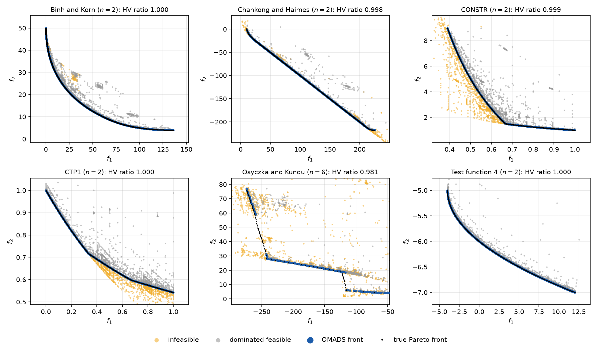
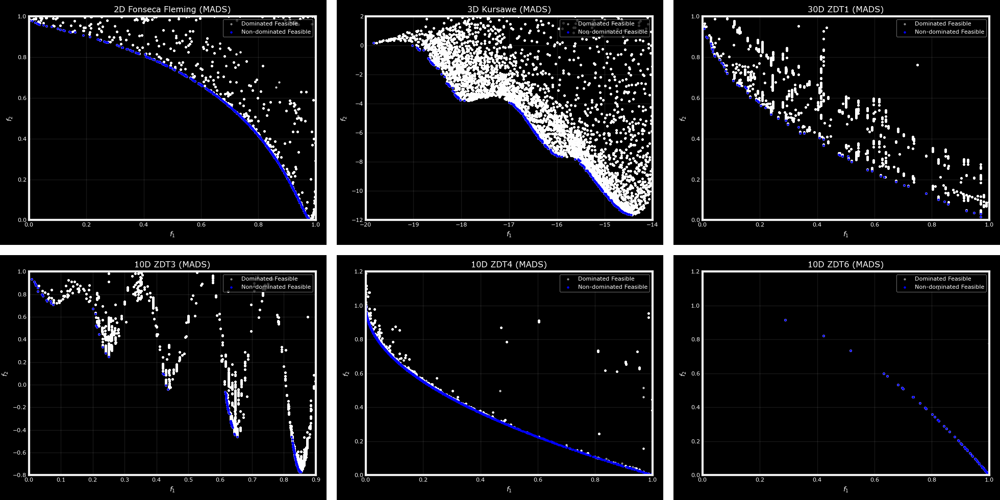

Multi-objective optimization
############################

OMADS can approximate the Pareto front of problems with several objectives. The blackbox
returns a list of objective values, and three parameters switch on the Pareto study:

.. code-block:: python

   def blackbox(x):
       return [[f1, f2], [c1, c2]]          # objectives first, then constraints

   param = {..., "nobj": 2, "is_pareto": True, "fun_names": ["f1", "f2"]}

Internally the adaptive barrier keeps the whole set of non-dominated points, each with its
own mesh, and the poll picks its frame centre where the front has the largest gaps (see
:numref:`A3`). The quality of the front is measured with the **hypervolume** indicator.

The Binh and Korn problem
=========================

.. math::

   \min_{x \in [0,5]\times[0,3]} \; \bigl(4x_1^2 + 4x_2^2,\; (x_1-5)^2 + (x_2-5)^2\bigr).

.. literalinclude:: scripts/multiobjective.py
   :language: python
   :caption: multiobjective.py

.. code-block:: text

   hypervolume = 0.8192
   312 non-dominated points, e.g.
         x1      x2         f1        f2
   0.000000 0.00000   0.000000 50.000000
   0.859375 0.75000   5.204102 35.207275
   1.687500 1.56250  21.156250 22.789062
   2.500000 2.46875  49.378906 12.657227
   3.437500 3.00000  83.265625  6.441406
   4.968750 3.00000 134.753906  4.000977

The front runs from :math:`(0, 50)` at :math:`x = (0, 0)` to the region around
:math:`x_2 = 3`, where the upper bound becomes active. ``out["xmin"]`` and ``out["fmin"]``
hold one point of the front; the whole front is in ``<name>_Pareto.out``. With
``ref_point`` and ``ideal_point``, ``HV`` is scaled to :math:`[0, 1]` by the box they bound,
so it can be compared across runs.

Gallery
=======

Pareto fronts obtained by OMADS on bi-objective test problems from the literature.

   Constrained bi-objective test problems solved by ``mads.main`` (one run, seed 0,
   5,000 evaluations), with the true Pareto fronts in black; produced by
   ``benchmarks/cmo/plot_constrained_mo.py``.

   Unconstrained bi-objective test problems.
