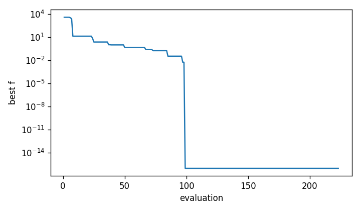

Results post-processing
#######################

OMADS can save the full evaluation history in a CSV file and the poll points of each
iteration in a JSON file, which can later be used to visualize the poll trajectory in 2D.
Both are written under ``param["post_dir"]``; see :doc:`../user_guide/outputs` for the
complete file layout.

Evaluation history
==================

Set ``options["save_results"]`` to ``True`` to write one row per evaluation to
``<post_dir>/<name>_run/<name>_all.out``. The script below runs MADS, loads the file with
pandas, prints its first rows and plots the best objective value against the number of
evaluations:

.. literalinclude:: scripts/postprocessing.py
   :language: python
   :caption: postprocessing.py

.. code-block:: text

    Iteration    Step   Status         fobj        best    x1    x2
            0 Poll_2n FEASIBLE  3609.000000 3609.000000 -2.00 -2.00
            0 Poll_2n FEASIBLE 14416.000000 3609.000000 -3.00 -3.00
            1 Poll_2n FEASIBLE 12116.000000 3609.000000 -3.00 -2.00
            1 Poll_2n FEASIBLE  5357.828125 3609.000000 -2.25 -2.25
            2 Poll_2n FEASIBLE  4317.203125 3609.000000 -2.25 -1.50
            2 Poll_2n FEASIBLE  3101.703125 3101.703125 -1.75 -2.50
   rows: 223 | evaluations by step: {'Search': 164, 'Poll_2n': 59}
   coords.json written to post/rosen_hist_run/

   Best objective value against the number of evaluations (Rosenbrock, ``mads.main``).

Rows labelled ``Search`` include the model-search points. On this problem they account for
most of the progress.

Coordinates JSON file
=====================

With ``options["save_coordinates"]`` set to ``True``, ``poll.main`` writes
``<post_dir>/<name>_run/coords.json``. It holds, for every iteration, the coordinates of
the evaluated poll points and the incumbent:

.. code-block:: json

   {
     "1": {
       "coord": [[-3.0, -3.0], [-3.0, -2.0]],
       "iter": 1,
       "x_incumbent": [-2.0, -2.0]
     },
     "2": {
       "coord": [[-2.25, -2.25], [-2.25, -1.5], [-1.75, -2.5], [-1.75, -1.75]],
       "iter": 2,
       "x_incumbent": [-2.0, -2.0]
     }
   }

A minimal animation of the poll trajectory with matplotlib:

.. code-block:: python

   import json
   import matplotlib.pyplot as plt
   from matplotlib.animation import FuncAnimation

   with open("post/rosen_hist_run/coords.json") as f:
       frames = list(json.load(f).values())

   fig, ax = plt.subplots()
   ax.set_xlim(-5, 10)
   ax.set_ylim(-5, 10)
   polls, = ax.plot([], [], "o", ms=4)
   center, = ax.plot([], [], "r*", ms=10)

   def draw(frame):
       xs, ys = zip(*frame["coord"])
       polls.set_data(xs, ys)
       center.set_data([frame["x_incumbent"][0]], [frame["x_incumbent"][1]])
       ax.set_title(f"iteration {frame['iter']}")
       return polls, center

   FuncAnimation(fig, draw, frames=frames, interval=150).save("poll.gif")

.. note::

   ``save_coordinates`` is supported by ``poll.main``. With ``mads.main`` it raises an
   ``IndexError`` at the end of the run in this release.
